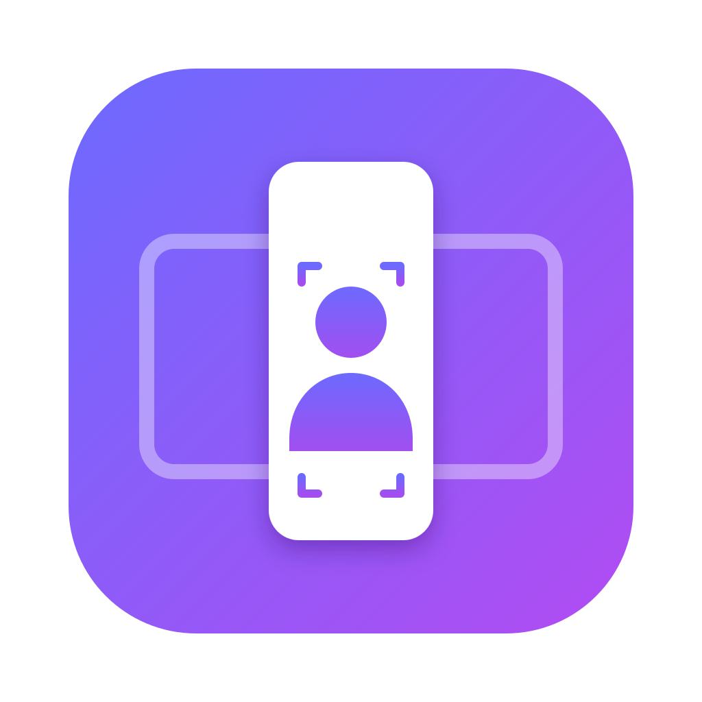

<h1 align="center">Video to Vertical</h1>

Turn part of any horizontal YouTube video (talks, sermons, podcasts, interviews, lectures) into a **vertical 1080×1920 clip that follows the speaker**, with noise cancellation. It's a standalone app: there's no Python or anything else to install.

## Download
Go to the **Releases** page and download the file for your computer:
- **Mac with an Apple chip (M1 or newer):** `VideoToVertical-mac-AppleSilicon.zip`
- **Older Intel Mac:** `VideoToVertical-mac-Intel.zip`
- **Windows 10/11:** `VideoToVertical-windows.zip`

To check which Mac you have, open the Apple menu and choose **About This Mac**. "Chip: Apple M…" means Apple Silicon.

## First time opening it
The app isn't signed with a paid Apple or Microsoft developer certificate, so your computer warns you once.

**Mac**
1. Unzip, then drag **Video to Vertical** into **Applications**.
2. Double-click it. When macOS says it can't verify the app, click **Done**.
3. Open **System Settings → Privacy & Security**, scroll down, and click **Open Anyway** next to Video to Vertical. Confirm with your password.

**Windows**
1. Right-click the zip, choose **Extract All**, and open the folder.
2. Double-click **Video to Vertical.exe**. If SmartScreen appears, click **More info → Run anyway**.

On first launch the app downloads two small helper tools (about 60 MB) and sets them up. From then on it opens straight away.

## Using it
1. Paste a YouTube link. A preview appears right away.
2. Set the **Start** and **End** times by typing them (e.g. `42:10`) or by pausing the preview and pressing **Set**. The preview plays just that section, and the badge shows the clip length (max 5 minutes). A link that already has a time in it (`&t=…`) fills in the start for you.
3. Adjust the sliders:
   - **Speaker tracking:** *Smooth* gives a calm camera that ignores small steps. *Locked on* keeps the speaker tightly centered. Starts at **100** (locked on). Lower it if the camera feels jumpy.
   - **Noise cancellation:** Starts at **20** for a light cleanup. Raise it to 30–50 for HVAC hum or hiss, and use 70+ only for very noisy rooms.
4. Click **Make vertical clip**. When it's done, use **Play** or **Show**. Clips are saved in a **Vertical Clips** folder in your home folder. Open **Logs** if you need details.

A 1-minute clip takes about 1–2 minutes on a typical laptop.

## Tips
- A waist-up camera shot gives the sharpest vertical crop. Choose "Best available" quality, especially for 4K streams.
- If the frame jumps to someone else (a host, an interpreter, someone in the background), move the tracking slider left a bit.
- The YouTube downloader updates itself daily. If downloads fail, quit and reopen the app.
- Only clip videos you own or have permission to use.

---

## For whoever maintains it: building new versions
Builds run automatically on GitHub, so nobody needs a Mac and a PC.

1. Create a GitHub repository and upload everything in this folder, **including the hidden `.github` folder**.
2. Every push to `main` (or **Actions → Build Video to Vertical apps → Run workflow**) builds the Mac (Apple Silicon + Intel) and Windows apps in about 10–15 minutes. Each app runs a self-test before it's published.
3. The finished zips appear under **Releases**. This link always points to the newest one:
   `https://github.com/<you>/<repo>/releases/latest`

To build on your own machine instead: `pip install -r requirements.txt`, then `python build.py`. The zip is created in `dist/`.

| File | What it is |
|---|---|
| `desktop.py` | The app (window + bridge to the engine) |
| `ui/index.html` | The window's design and preview player |
| `assets/` | Logo |
| `core.py` | Download, speaker tracking, vertical crop, audio cleanup |
| `build.py` | Packages the app for the current computer |
| `.github/workflows/build.yml` | Builds all three versions on GitHub |
